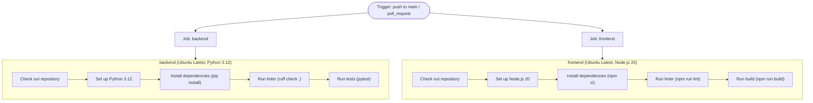

# CI/CD Pipeline Documentation

This document describes the continuous integration pipeline for **Online Seller Assistant** as defined in `.github/workflows/ci.yml`.

---

## Current Baseline Pipeline

### Triggers
- **`pull_request`**: Runs on any pull request targeting the repository.
- **`push` to `main`**: Runs on every merge or push to the `main` branch.

### Execution Model
The pipeline executes two parallel jobs on `ubuntu-latest` with a strict `10-minute` timeout per job.

---

### Existing Stages & Rationale

#### 1. `backend` Job
- **Working Directory**: `backend`
- **Runner Environment**: `ubuntu-latest`
- **Python Version**: `3.12`
- **Timeout**: 10 minutes

| Stage | Command | Purpose / Rationale |
|---|---|---|
| **Check out repository** | `actions/checkout@v4` | Fetches the commit code into the GitHub Actions runner. |
| **Set up Python 3.12** | `actions/setup-python@v5` | Configures the isolated Python 3.12 runtime environment. |
| **Install dependencies** | `python -m pip install --upgrade pip` `pip install -r requirements.txt` | Installs FastAPI, SQLAlchemy, Uvicorn, Ruff, Pytest, and related dependencies. |
| **Run linter (Ruff)** | `ruff check .` | Fast static analysis enforcing code conventions, typing standards, and PEP 8 guidelines. |
| **Run tests (Pytest)** | `pytest` | Executes unit tests (including `/health` endpoint and CORS checks) with mocked database connectivity. Never calls external APIs. |

#### 2. `frontend` Job
- **Working Directory**: `frontend`
- **Runner Environment**: `ubuntu-latest`
- **Node.js Version**: `20`
- **Timeout**: 10 minutes

| Stage | Command | Purpose / Rationale |
|---|---|---|
| **Check out repository** | `actions/checkout@v4` | Fetches the commit code into the GitHub Actions runner. |
| **Set up Node.js 20** | `actions/setup-node@v4` | Configures the Node.js 20 LTS runtime environment. |
| **Install dependencies** | `npm ci` | Clean, deterministic installation of packages matching `package-lock.json`. |
| **Run linter (ESLint)** | `npm run lint` | Enforces JavaScript syntax standards and React hooks/refresh rules. |
| **Run build (Vite)** | `npm run build` | Compiles JSX, validates Tailwind CSS processing, and packages production assets to verify build viability before merge. |

---

## Planned Pipeline Enhancements

The baseline pipeline will be expanded across project sprints:

### Sprint 2
- **Dependency Caching**: Cache pip wheels and npm modules to minimize runner setup duration.
- **API Tests**: Automated integration tests targeting backend endpoints.

### Sprint 3
- **Mocked OpenAI Tests**: Unit and integration test suites validating agent orchestration without calling live OpenAI endpoints.
- **Prompt Evaluation Run**: Automated evaluation workflow triggered whenever prompt template files are modified.
- **Scheduled Live Smoke Test**: Periodic scheduled cron workflow checking live staging/production `/health` endpoints.
- **Secret Scanning**: Automated credential and token leakage scanning on commits and PRs.

### Sprint 4
- **Tagged Release**: Automated release packaging triggered on semantic version tags.
- **Rollback Test**: Automated validation procedures to confirm rollback integrity.
