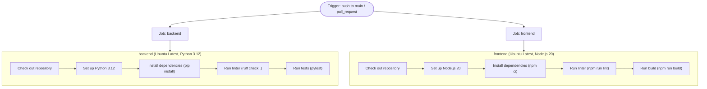

# CI/CD Pipeline Documentation

This document describes the continuous integration pipeline for **Online Seller Assistant** as defined in `.github/workflows/ci.yml`.

---

## Current Baseline Pipeline

### Triggers
- **`pull_request`**: Runs on any pull request targeting the repository.
- **`push` to `main`**: Runs on every merge or push to the `main` branch.

### Execution Model
The pipeline executes two parallel jobs on `ubuntu-latest` with a strict `10-minute` timeout per job.

---

### Existing Stages & Rationale

#### 1. `backend` Job
- **Working Directory**: `backend`
- **Runner Environment**: `ubuntu-latest`
- **Python Version**: `3.12`
- **Timeout**: 10 minutes

| Stage | Command | Purpose / Rationale |
|---|---|---|
| **Check out repository** | `actions/checkout@v4` | Fetches the commit code into the GitHub Actions runner. |
| **Set up Python 3.12** | `actions/setup-python@v5` | Configures the isolated Python 3.12 runtime environment. |
| **Install dependencies** | `python -m pip install --upgrade pip` `pip install -r requirements.txt` | Installs FastAPI, SQLAlchemy, Uvicorn, Ruff, Pytest, and related dependencies. pip downloads are cached by `actions/setup-python` (keyed on `requirements.txt`). |
| **Run linter (Ruff)** | `ruff check .` | Fast static analysis enforcing code conventions, typing standards, and PEP 8 guidelines. |
| **Run tests (Pytest)** | `pytest` | Runs the backend suite: health/CORS, product CRUD, all three agents' validation gates with scripted fake AI clients, AI failure simulation, and rate limits. It uses in-memory SQLite, and `tests/conftest.py` removes any OpenAI key, so it never calls external APIs. |

#### 2. `frontend` Job
- **Working Directory**: `frontend`
- **Runner Environment**: `ubuntu-latest`
- **Node.js Version**: `20`
- **Timeout**: 10 minutes

| Stage | Command | Purpose / Rationale |
|---|---|---|
| **Check out repository** | `actions/checkout@v4` | Fetches the commit code into the GitHub Actions runner. |
| **Set up Node.js 20** | `actions/setup-node@v4` | Configures the Node.js 20 LTS runtime environment. |
| **Install dependencies** | `npm ci` | Clean, deterministic installation of packages matching `package-lock.json`. The npm cache is restored by `actions/setup-node` (keyed on `package-lock.json`). |
| **Run linter (ESLint)** | `npm run lint` | Enforces JavaScript syntax standards and React hooks/refresh rules. |
| **Run build (Vite)** | `npm run build` | Compiles JSX, validates Tailwind CSS processing, and packages production assets to verify build viability before merge. |

---

## Deployment (CD)

CI does not deploy; the hosting platforms deploy from GitHub:

- **Backend:** Render auto-deploys the `main` branch using `render.yaml`. `/health` is the health check, so a release that cannot reach the database is not promoted.
- **Frontend:** Vercel deploys `main` to production and builds a preview deployment for every pull request. The preview link is posted on the PR.
- **Merge → live:** merging a pull request into `main` triggers both deploys. This was verified when PR #14 was merged.

Rollback steps are in [runbook.md](runbook.md#2-rollback).

---

## Pipeline Enhancements

### Done
- **Dependency caching:** pip and npm caches in both jobs (Sprint 2).
- **API tests:** endpoint tests for products, agents, listings, health, and rate limits (Sprint 2).
- **Mocked OpenAI tests:** agent orchestration and validation are tested with scripted fake clients, never live OpenAI (Sprint 3).

### Planned

### Sprint 3
- **Prompt Evaluation Run**: Automated evaluation workflow triggered whenever prompt template files are modified.
- **Scheduled Live Smoke Test**: Periodic scheduled cron workflow checking live staging/production `/health` endpoints.
- **Secret Scanning**: Automated credential and token leakage scanning on commits and PRs.

### Sprint 4
- **Tagged Release**: Automated release packaging triggered on semantic version tags.
- **Rollback Test**: Automated validation procedures to confirm rollback integrity.
