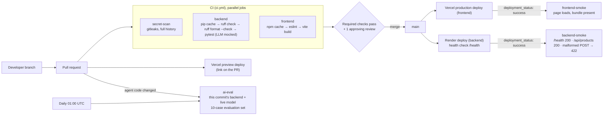

# CI/CD Pipeline

How code gets from a developer's branch to production for **Online Seller Assistant**. The pipeline lives in three GitHub Actions workflows in `.github/workflows/`. Deploys are done by Render (backend) and Vercel (frontend) on every merge to `main`.

| Workflow | File | Trigger | Purpose |
|---|---|---|---|
| **CI** | `ci.yml` | every pull request; every push to `main` | Quality gate: secrets, lint, format, tests, build |
| **Post-deploy smoke test** | `post-deploy.yml` | GitHub `deployment_status` events from Render and Vercel | Verify the live service after each successful production deploy |
| **AI evaluation** | `ai-eval.yml` | PRs that change `backend/app/agents/**` or `backend/evals/**`; daily at 01:00 UTC; manual | Run the evaluation set against the PR's own code, and run a daily live check of the AI provider |

## Pipeline diagram

## Quality gates
Branch protection on `main`, as configured in GitHub on 2026-11-26:
- **Pull request required:** no direct pushes. Every change lands through a pull request.
- **Required review:** 1 approving review before merging.
- **Required status check:** `backend`.
- **Cancel outdated runs:** a new push to the same PR branch cancels the outdated CI run (`concurrency`, `cancel-in-progress`). Runs on `main` are never cancelled.

**Still to tighten** (in Settings → Branches → `main`):
- Add `frontend` and `secret-scan` as required status checks.
- Enable "Dismiss stale approvals when new commits are pushed".
- Enable "Do not allow bypassing the above settings", which currently lets administrators skip the rules.

## CI stages and why each exists

### `secret-scan` job
| Stage | Command | Why |
|---|---|---|
| Checkout, full history | `actions/checkout@v4` with `fetch-depth: 0` | gitleaks needs every commit to prove no secret was *ever* committed, not just in the latest code. |
| Secret scan | `gitleaks/gitleaks-action@v2` | Fails the PR if a key, token, or connection string shows up in any commit. It runs in parallel, so it adds no time to the critical path. |

### `backend` job (Python 3.12, 10-minute timeout)
| Stage | Command | Why |
|---|---|---|
| Set up Python with pip cache | `actions/setup-python@v5` (`cache: pip`) | Matches production (Render is pinned to 3.12.7). The cache avoids re-downloading packages. |
| Install | `pip install -r requirements.txt` | Same dependency set as production. |
| Lint | `ruff check .` | The cheapest check runs first, so it fails fast. |
| Format check | `ruff format . --check` | Keeps diffs readable, enforced by the pipeline instead of by reviewers. |
| Tests | `pytest` | 61 tests: product CRUD, validation, error handling, all three agents' gates with scripted fake AI clients, AI failure simulation, rate limits, health/CORS. In-memory SQLite. `tests/conftest.py` removes any real AI key, so CI costs $0 and doesn't depend on the AI provider being up. |

### `frontend` job (Node 20, 10-minute timeout)
| Stage | Command | Why |
|---|---|---|
| Set up Node with npm cache | `actions/setup-node@v4` (`cache: npm`) | Faster installs. |
| Install | `npm ci` | Exact versions from `package-lock.json`. |
| Lint | `npm run lint` | React hooks and code-quality rules. |
| Build | `npm run build` | Catches broken imports or JSX before merge; the same build Vercel runs. |

## Deployment (CD)
CI doesn't deploy. The hosting platforms deploy from GitHub with no manual steps:

- **Backend, Render:** auto-deploys `main` using `render.yaml` (Blueprint).
  - Render waits for `/health` to return 200 before switching traffic, so a release that can't reach the database isn't promoted.
  - Secrets are set in Render's environment settings (`sync: false`), never in the repository.
- **Frontend, Vercel:** deploys `main` to production. Every PR gets its own **preview** deployment, linked on the PR.
- **After a deploy:** Render and Vercel report each deploy to GitHub, and `post-deploy.yml` smoke-tests the live service when a production deploy succeeds.

Rollback: see [runbook.md](runbook.md#2-rollback). Releases are tagged (`v1.0.0`), with notes in [CHANGELOG.md](../CHANGELOG.md).

## AI-specific concerns
| Concern | How it's handled |
|---|---|
| **Cost and flakiness** | Unit tests never call a live model (mocked clients plus `conftest.py`). Live calls happen only in `ai-eval.yml`. |
| **Prompt changes are code changes** | `ai-eval.yml` runs the 10-case evaluation set (`backend/evals/`) against the PR's own backend whenever agent code changes. |
| **Non-determinism** | The evaluation checks shape and safety (three platforms, no invented claims, clean hashtags, grounded titles), not exact wording. |
| **Provider outages** | They never block deploys: CI is fully mocked, and the app falls back to rule-based output. The daily evaluation and the `X-Simulate-AI-Failure` header cover outage rehearsal. |
| **Key hygiene** | CI uses separate repository secrets (`EVAL_OPENAI_API_KEY`, `EVAL_OPENAI_BASE_URL`, `EVAL_OPENAI_MODEL`) from production's Render secret. If the secret is missing, the evaluation job skips with a note instead of failing. |

## Metrics and history
Weekly numbers are in [metrics-log.md](metrics-log.md), optimizations in [optimization-log.md](optimization-log.md), and incidents with postmortems in [incident-log.md](incident-log.md).
