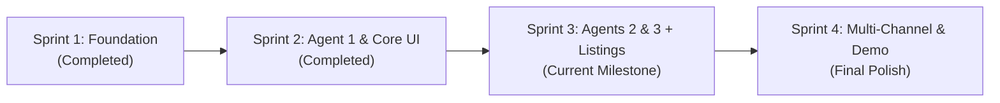

# 📋 Online Seller Assistant — Sprint Deliverables & Team Guide

> **Project:** Online Seller Assistant (Autonomous Multi-Agent AI System)  
> **Repository:** `https://github.com/BenaiahAsis/online-seller-assistant`  
> **Architecture:** FastAPI (Backend) &bull; React Vite (Frontend) &bull; PostgreSQL (Neon) &bull; Render + Vercel  

This document outlines the **complete roadmap across all 4 sprints**, specifying exactly what has been completed and step-by-step action items for each team member for **Sprint 3 and Sprint 4**.

---

## 👥 Team Roles & Ownership

| Member | Role | Primary Focus |
|---|---|---|
| **Benaiah Asis** | DevOps & Scrum Lead | CI/CD pipelines, cloud deployment, database infrastructure, PR reviews |
| **Ken Matthew Navarro** | AI & Integrations Engineer | Agent 2 & Agent 3 prompt engineering, OpenAI structured output, fallback heuristics |
| **Al Rodge Rendal** | Backend Lead | Database schemas, SQLAlchemy models, FastAPI REST endpoints, agent orchestration |
| **Joan Ballarta** | Frontend Lead | React UI components, listing cards, platform preview switchers, user interactions |
| **Ruelyn Jose** | QA & Testing Engineer | Pytest test suites, edge case verification, linter checks, test documentation |

---

## 🗺️ Master Sprint Roadmap



---

## 📌 Sprint Breakdown & Deliverables

### ✅ Sprint 1: Foundation & DevOps Setup (COMPLETED)
- [x] Monorepo structure with `backend/` and `frontend/`.
- [x] Cloud PostgreSQL instance provisioned on Neon with connection verification (`SELECT 1`).
- [x] FastAPI health check endpoint (`GET /health`) returning live database status.
- [x] Initial React + Tailwind monitoring UI showing real-time connectivity status.
- [x] GitHub Actions CI pipeline running Ruff (backend) and ESLint + Vite build (frontend).
- [x] Live cloud hosting configured: Backend on **Render**, Frontend on **Vercel**.

---

### ✅ Sprint 2: Core Analysis Agent & Data Pipeline (COMPLETED)
- [x] **CI/CD Optimization**: Added `pip` and `npm` dependency caching to `.github/workflows/ci.yml`.
- [x] **Database Schema**: Created `Product` and `ProductAnalysis` SQLAlchemy 2.0 models.
- [x] **Agent 1 (Product Analysis Agent)**:
  - Extracts category, target audience, specifications, selling points, and keywords.
  - Implemented with hybrid OpenAI API + deterministic rule-based fallback for CI safety.
- [x] **REST API Endpoints**:
  - `POST /api/products` (Create product)
  - `GET /api/products` (List catalog)
  - `GET /api/products/{id}` (Retrieve item)
  - `POST /api/products/{id}/analyze` (Trigger Agent 1)
- [x] **Frontend Workbench**:
  - Two-tab navigation: **Agent 1: Product Analyzer** and **System Health (DevOps)**.
  - Seller input form with 1-click sample demo pre-fills.
  - Structured output visualization with clickable SEO keywords.
  - Saved product catalog connected to Neon PostgreSQL.
- [x] **Testing**: 11/11 automated tests passing via in-memory SQLite fixture.

---

### 🚀 Sprint 3: Agents 2 & 3 + Listing Generation (CURRENT SPRINT)
*Goal: Complete the remaining two agents in the sequential 3-agent pipeline and allow sellers to generate and preview ready-to-use e-commerce listings.*

#### 1. Ken Matthew Navarro (AI & Integrations Engineer)
- [ ] **Agent 2 (Market Analysis Agent)** (`backend/app/agents/market_analyzer.py`):
  - Take Agent 1's structured profile (category, target audience, selling points).
  - Generate competitive market insights: buyer psychological triggers, key differentiator, and platform tone recommendations (e.g., Casual/Hype for TikTok, Informative/Direct for Shopee).
- [ ] **Agent 3 (Listing Generation Agent)** (`backend/app/agents/listing_generator.py`):
  - Combine Agent 1 specs + Agent 2 market analysis.
  - Generate 3 platform-tailored listings:
    1. **Shopee/Lazada Listing**: High-converting title (under 120 chars), formatted bullet-point features, warranty/specs block.
    2. **TikTok Shop / Social Caption**: Punchy hook, benefit-driven body, top 5 trending hashtags.
    3. **Instagram / Short Post**: Clean, aesthetic copy with emoji formatting and call-to-action.
- [ ] Add offline fallback logic for both agents so tests never depend on live API keys.

#### 2. Al Rodge Rendal (Backend Lead)
- [ ] **Database Model** (`backend/app/models.py`):
  - Create `ProductListing` model linked to `Product` (`product_id`, `platform`, `title`, `description`, `bullet_points`, `hashtags`, `created_at`).
- [ ] **Pydantic Schemas** (`backend/app/schemas.py`):
  - Add `ListingResponse`, `MarketAnalysisResponse`, and `FullPipelineResponse`.
- [ ] **REST Endpoints** (`backend/app/main.py`):
  - `POST /api/products/{id}/market-analysis` (Run Agent 2)
  - `POST /api/products/{id}/generate-listings` (Run Agent 3)
  - `POST /api/products/{id}/full-pipeline` (Executes Agent 1 &rarr; Agent 2 &rarr; Agent 3 sequentially in one request).

#### 3. Joan Ballarta (Frontend Lead)
- [ ] **Listing Preview Tab** (`frontend/src/`):
  - Add a third tab: **"Generated Listings"** (or expandable panel below the analyzer).
  - Platform toggle buttons: `[Shopee / Lazada]` `[TikTok Shop]` `[Instagram]`.
  - Render generated title, formatted description with bullet points, and hashtag pills.
- [ ] **Interactive Seller Controls**:
  - **"Copy to Clipboard"** button with a "Copied!" feedback badge.
  - Inline editable text area allowing sellers to tweak the AI listing before copying.
  - One-click **"Run Full 3-Agent Pipeline"** button in the main form.

#### 4. Ruelyn Jose (QA & Testing Engineer)
- [ ] **Automated Test Suite** (`backend/tests/test_agents.py`):
  - Test Agent 2 output structure (validating returned JSON fields).
  - Test Agent 3 listing formats for Shopee and TikTok.
  - Test full sequential pipeline endpoint (`/api/products/{id}/full-pipeline`).
- [ ] **Edge Case Handling**:
  - Empty description/features input.
  - Extremely long product names (> 200 characters).
  - Special characters and unicode emojis.
- [ ] Record test metrics and coverage in `docs/metrics-log.md`.

#### 5. Benaiah Asis (DevOps & Scrum Lead)
- [ ] Review PRs and enforce CI checks before merging into `main`.
- [ ] Verify Render backend deployment and Neon DB auto-table creation for `ProductListing`.
- [ ] Track sprint velocity and log any pipeline/database incidents in `docs/incident-log.md`.

---

### 🏁 Sprint 4: Multi-Channel Publishing & Final Pitch (UPCOMING)
*Goal: Final system polish, export tools, latency/cost evaluation, and presentation demo prep.*

- [ ] **Export Options**: Export listing as `.txt` or `.json` for easy copy-pasting into seller portals.
- [ ] **Performance & AI Metrics**: Measure and log average agent latency (seconds) and token cost per listing in `docs/metrics-log.md`.
- [ ] **Final Team Pitch Rehearsal**:
  - **Benaiah**: Architecture, CI/CD, database reliability, and cloud deployment overview.
  - **Ken & Al**: Multi-agent sequential pipeline, prompt engineering, and fallback design.
  - **Joan**: Live UI walkthrough (creating product &rarr; AI analysis &rarr; generated listings).
  - **Ruelyn**: Automated testing, quality assurance, and edge case handling.

---

## 🛠️ Step-by-Step: How to Pick Up Your Task (Git Workflow)

Follow these exact steps to ensure your code integrates smoothly with the CI/CD pipeline:

### Step 1: Update your local `main` branch
```bash
git checkout main
git pull origin main
```

### Step 2: Create your feature branch
Always name your branch starting with `feature/`:
```bash
# Ken (Agent 2 & 3):
git checkout -b feature/agents-2-and-3

# Al (Backend Endpoints & Listing Model):
git checkout -b feature/listing-endpoints

# Joan (Frontend Listing UI):
git checkout -b feature/listings-ui

# Ruelyn (Agent Tests):
git checkout -b feature/qa-agent-tests
```

### Step 3: Test locally before pushing!
Make sure the automated linters and tests pass on your machine first:
```bash
# In backend/
ruff check .
pytest

# In frontend/
npm run lint
npm run build
```

### Step 4: Commit and Push
```bash
git add .
git commit -m "feat: your concise commit message"
git push -u origin your-branch-name
```

### Step 5: Open a Pull Request on GitHub
1. Go to `https://github.com/BenaiahAsis/online-seller-assistant`.
2. Click **"Compare & pull request"**.
3. Select `base: main` &larr; `compare: your-branch-name`.
4. Fill in the description summarizing what you built.
5. Notify **Benaiah Asis** to review and merge!
