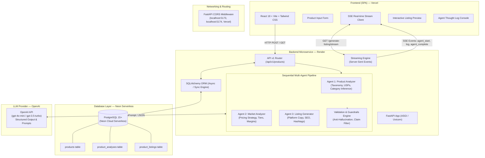
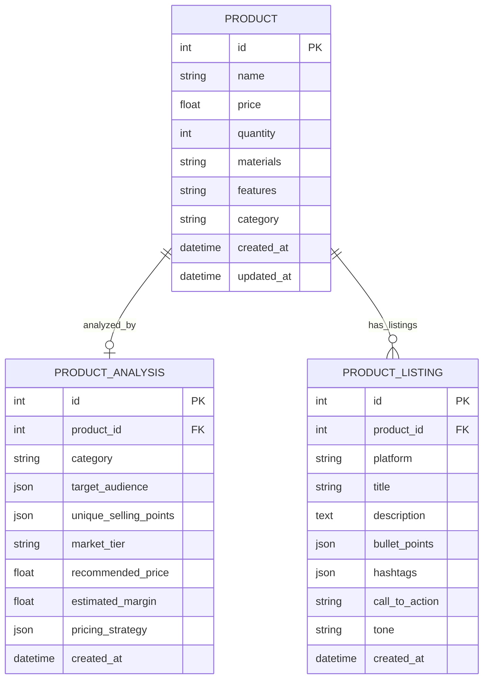
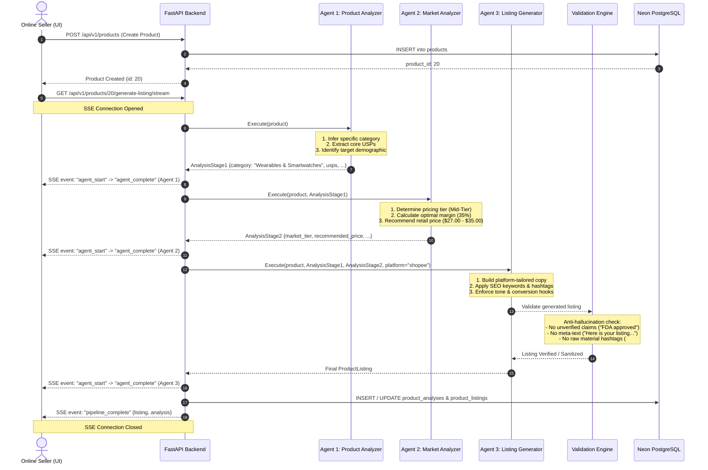
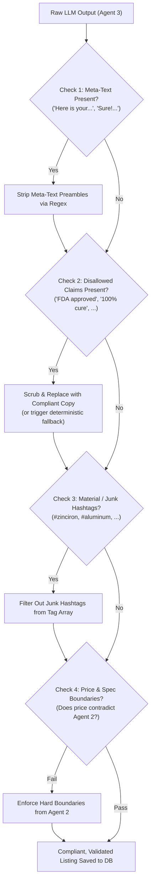
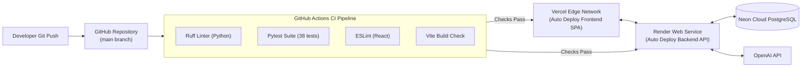

# Online Seller Assistant — System Architecture & Technical Design Document

> **Version:** 2.0.0  
> **Status:** Production  
> **Target Audience:** Engineering, AI Assistants (Claude / GPT), Technical Reviewers  
> **Live Web App:** [https://online-seller-assistant-three.vercel.app](https://online-seller-assistant-three.vercel.app)  
> **Live API (Render):** [https://online-seller-assistant-backend.onrender.com](https://online-seller-assistant-backend.onrender.com)  
> **API Swagger Docs:** [https://online-seller-assistant-backend.onrender.com/docs](https://online-seller-assistant-backend.onrender.com/docs)  
> **Repository:** [https://github.com/BenaiahAsis/online-seller-assistant](https://github.com/BenaiahAsis/online-seller-assistant)

---

## 1. Executive Summary & Overview

**Online Seller Assistant** is an AI-powered SaaS and microservice platform built for Southeast Asian and global e-commerce sellers (Shopee, Lazada, TikTok Shop, Carousell, and Instagram). It takes raw, unstructured or semi-structured product details (product name, unit cost, quantity, materials, features) and automatically executes an end-to-end, multi-agent AI pipeline to:

1. **Extract & Classify:** Infer deep product taxonomy, detect exact categories (e.g. Wearables & Smartwatches vs. General Merchandise), categorize target demographics, and extract unique selling propositions (USPs).
2. **Formulate Market Strategy:** Determine market competitive tiering (budget, mid-tier, premium), optimal markup margins, competitor pricing corridors, and audience positioning.
3. **Generate High-Converting Listings:** Produce platform-tailored, SEO-optimized listing titles, bulleted feature benefits, persuasive descriptions, localized call-to-actions, and high-impact search hashtags.
4. **Enforce Strict Guardrails:** Run an anti-hallucination validation engine that enforces truthfulness, blocks unverified regulatory claims (e.g. fake "FDA approved" statements), strips AI meta-text ("Here is your listing..."), and validates price boundaries.
5. **Stream Execution in Real-Time:** Expose live agent execution events to the frontend via Server-Sent Events (SSE) so sellers can see the multi-agent chain of thought in real-time.

---

## 2. High-Level Architecture & Tech Stack



### Technology Breakdown

| Component | Technology | Rationale |
| :--- | :--- | :--- |
| **Frontend Framework** | React 18, Vite | Instant hot reload, blazing fast build, small bundle size |
| **Styling & Icons** | Tailwind CSS, Lucide React | Modern responsive design, dark/light theme ready, accessible UI |
| **Backend Framework** | FastAPI (Python 3.11+) | Asynchronous high-performance web framework, native Pydantic validation, OpenAPI/Swagger docs auto-generation |
| **Concurrency / Streaming** | `sse-starlette` / `StreamingResponse` | Native Server-Sent Events (SSE) streaming for live agent telemetry without WebSocket overhead |
| **ORM & Database** | SQLAlchemy 2.0, Neon PostgreSQL | Serverless cloud PostgreSQL with connection pooling, declarative data models, reliable ACID transactions |
| **AI / LLM Integration** | OpenAI API (`gpt-4o-mini` centralized via `Settings`) | Configurable via `OPENAI_MODEL` setting, low latency, structured JSON mode, deterministic fallback resilience |
| **Rate Limiting** | SlowAPI (Limits) | 5 requests/min per IP on listing generation endpoints with HTTP 429 backoff |
| **Validation & Safety** | Custom Rule Engine + Pydantic v2 | Anti-hallucination validation, unverified claim redaction, regex formatting filters |
| **Deployment / CI** | GitHub Actions, Vercel, Render | Automated linting, pytest testing, continuous deployment on every git push to `main` |

---

## 3. Database Schema & Data Models

The relational schema is normalized into three core entities representing the lifecycle of an e-commerce product analysis.



### Table Definitions

#### `products` Table
Stores raw merchant input submitted via the frontend or API.
- `id` (Integer, Primary Key, Auto-increment)
- `name` (String(255), Not Null) — e.g. "Smartwatch"
- `price` (Float, Not Null) — Merchant cost/base price (e.g. `20.00`)
- `quantity` (Integer, Default: 0) — Available stock inventory
- `materials` (Text, Nullable) — e.g. "aluminum, zinc iron, glass"
- `features` (Text, Nullable) — e.g. "Free strap, Most bought item"
- `category` (String(100), Nullable) — Auto-assigned category from Agent 1
- `created_at` / `updated_at` (DateTime with timezone)

#### `product_analyses` Table
Stores intermediate intelligence generated collaboratively by Agent 1 (Product Analyzer) and Agent 2 (Market Analyzer).
- `id` (Integer, Primary Key)
- `product_id` (Integer, Foreign Key -> `products.id`, Unique)
- `category` (String(100)) — Refined category (e.g. "Electronics & Wearables")
- `target_audience` (JSON/Array) — Primary personas (e.g. `["Fitness Enthusiasts", "Tech-Savvy Professionals"]`)
- `unique_selling_points` (JSON/Array) — Extracted selling points
- `market_tier` (String) — `"Budget"`, `"Mid-Tier"`, or `"Premium"`
- `recommended_price` (Float) — Calculated optimal retail listing price
- `estimated_margin` (Float) — Estimated gross profit margin (e.g. `0.35` for 35%)
- `pricing_strategy` (JSON) — Detailed breakdown including floor price, competitor price range, and discounting tactics

#### `product_listings` Table
Stores final platform-tailored marketing listings generated by Agent 3 (Listing Generator).
- `id` (Integer, Primary Key)
- `product_id` (Integer, Foreign Key -> `products.id`)
- `platform` (String(50)) — `"shopee"`, `"lazada"`, `"tiktok"`, `"carousell"`, or `"instagram"`
- `title` (String(255)) — SEO-optimized, click-worthy product title
- `description` (Text) — Compelling body copy highlighting benefits
- `bullet_points` (JSON/Array) — Key feature highlights formatted for mobile scanning
- `hashtags` (JSON/Array) — High-volume and niche discovery tags (e.g. `["#Smartwatch", "#WearableTech"]`)
- `call_to_action` (String(255)) — Platform-appropriate urgency statement
- `tone` (String(50)) — e.g. `"Professional"`, `"Persuasive"`, `"Conversational"`

---

## 4. The 3-Agent Sequential Pipeline

The core intelligence of the system uses a **pipelined multi-agent workflow** with separation of concerns. Rather than running a monolithic LLM prompt that suffers from context dilution and hallucinations, work is partitioned across three specialized agents.



---

### Deep Dive: Agent Specifications

#### Agent 1: Product Analyzer (`backend/app/agents/product_analyzer.py`)
- **Mission:** Extract structure and semantic meaning from raw merchant input.
- **Category Inference Logic:** Uses rule-based keyword mapping combined with LLM semantic understanding to assign precise, standard retail categories:
  - Smartwatch, tracker, watch -> `"Wearables & Smartwatches"`
  - Headphone, earphone, speaker -> `"Audio & Accessories"`
  - Serum, lotion, skincare -> `"Beauty & Personal Care"`
  - Shirt, dress, pants -> `"Fashion & Apparel"`
  - *Never defaults to generic "General Merchandise" when name/materials contain clear indicators.*
- **Output:** Categorized product identity, target personas, and extracted USPs.

#### Agent 2: Market Analyzer (`backend/app/agents/market_analyzer.py`)
- **Mission:** Formulate competitive commercial strategy based on cost and positioning.
- **Pricing Strategy Algorithm:**
  - Evaluates cost structure ($20 base cost).
  - Determines competitive market tier: Budget (<$15), Mid-Tier ($15-$75), Premium (>$75).
  - Calculates target margin multiplier (e.g. 1.35x - 1.6x for 35%-60% gross profit).
  - Identifies competitor benchmarks and promotion corridors (e.g. bundle discounts, flash-sale buffers).
- **Output:** Pricing recommendation, margin estimation, and competitive positioning report.

#### Agent 3: Listing Generator (`backend/app/agents/listing_generator.py`)
- **Mission:** Synthesize product specs and market strategy into high-converting e-commerce listings tailored to the selected platform.
- **Platform Customizations:**
  - **Shopee / Lazada:** SEO keyword-dense titles, emoji feature benefit bullets, search-indexed hashtags.
  - **TikTok Shop:** Short, snappy, hook-first conversational tone, viral and trending challenge tags.
  - **Carousell:** Authentic seller tone, clear condition, meet-up or delivery terms.
  - **Instagram:** Aesthetic storytelling, lifestyle context, curated aesthetic hashtags.
- **Strict Anti-Hallucination & Style Rules:**
  1. **Forbidden Title Prefix:** Never prefix titles with `{name} - ` (e.g. *Forbidden:* `Smartwatch - Modern Smartwatch...`).
  2. **No AI Meta-Text:** Strip conversational preambles such as *"Here is your optimized listing:"* or *"Certainly! Below is the listing:"*.
  3. **No Raw Material Hashtags:** Never create hashtags for base metals or chemical names (e.g. never `#zinciron`, `#aluminumiron`).
  4. **Hype Claim Softening:** Soften unverified merchant claims like *"Most bought item"* into believable marketing phrases like *"Customer Favorite"* or *"Top Trending Pick"*.
  5. **Banned Health / Regulatory Claims:** Strictly prohibit claims of medical efficacy, cure, or unauthorized regulatory approval (e.g. "FDA approved", "Clinically proven to cure").

---

## 5. Anti-Hallucination & Validation Engine (`backend/app/agents/validation.py`)

To ensure enterprise-grade reliability and legal compliance for merchants, all generated copy passes through a deterministic validation and sanitization gate before persistence.



### Safety Rules Enforced:
1. **Unverified Regulatory Claims:** Any mention of "FDA approved", "CE certified" (unless explicitly provided in verified product input) is scrubbed.
2. **Medical Guarantee Claims:** Blocks "cures", "prevents disease", "100% clinically proven".
3. **Preamble / Postamble Stripping:** Removes model pleasantries and markdown wrapping artifacts.
4. **Hashtag Filtering:** Only tags relating to lifestyle, category, or real consumer search terms are retained.

---

## 6. Real-Time Telemetry & Streaming (SSE)

Unlike traditional APIs where users wait 8–15 seconds looking at a generic spinner, Online Seller Assistant implements a **Server-Sent Events (SSE)** architecture:

- **Endpoint:** `GET /api/v1/products/{id}/generate-listing/stream?platform=shopee`
- **Protocol:** `text/event-stream` over HTTP/1.1 or HTTP/2
- **Event Schema:**
  ```json
  event: agent_start
  data: {"agent": "product_analyzer", "step": 1, "message": "Analyzing product specifications and extracting USPs..."}

  event: agent_complete
  data: {"agent": "product_analyzer", "step": 1, "result": {"category": "Wearables & Smartwatches"}}

  event: agent_start
  data: {"agent": "market_analyzer", "step": 2, "message": "Evaluating market pricing corridors and target margins..."}

  event: agent_complete
  data: {"agent": "market_analyzer", "step": 2, "result": {"market_tier": "Mid-Tier", "recommended_price": 27.0}}

  event: agent_start
  data: {"agent": "listing_generator", "step": 3, "message": "Generating Shopee-optimized listing and running safety validation..."}

  event: pipeline_complete
  data: {"status": "success", "listing": {...}, "analysis": {...}}
  ```
The frontend consumes this stream using the native browser `EventSource` API, rendering an interactive terminal console with live agent thought traces.

---

## 7. REST API Endpoints

All endpoints are versioned under `/api/v1`.

| Method | Endpoint | Description | Request Body | Response |
| :--- | :--- | :--- | :--- | :--- |
| `GET` | `/health` | Keep-alive friendly database health check (`SELECT 1`) | None | `{"status": "healthy", "database": "connected"}` |
| `POST` | `/api/products` | Create new product record | `ProductCreate` JSON | `ProductResponse` (id, name, price, ...) |
| `GET` | `/api/products` | List all merchant products | None | `ProductListResponse` |
| `GET` | `/api/products/{id}` | Retrieve product by ID | None | `ProductResponse` |
| `POST` | `/api/products/{id}/generate-listings` | Execute Agent 3 listing generation **(Rate limited: 5 req/min per IP)** | None | `List[ProductListingResponse]` |
| `POST` | `/api/products/{id}/full-pipeline` | Execute full 3-agent pipeline synchronously **(Rate limited: 5 req/min per IP)** | None | `FullPipelineResponse` |
| `GET` | `/api/products/{id}/logs` | Retrieve audit & execution logs for all agents | None | `List[Dict[str, Any]]` |
| `PATCH` | `/api/listings/{listing_id}` | Customize title, bullets, or description | `ListingUpdate` JSON | `ProductListingResponse` |
| `GET` | `/api/products/{id}/listings` | Retrieve generated platform listings | None | `List[ProductListingResponse]` |

---

## 8. Frontend UI / UX Architecture

```
frontend/src/
├── components/
│   ├── ProductForm.jsx          # Input form with validation, price formatting, tags
│   ├── ListingPreview.jsx       # Multi-platform tab view (Shopee, Lazada, TikTok, etc.)
│   ├── MarketStrategyCard.jsx   # Visual breakdown of margins, pricing tier, audience
│   ├── AgentLogsConsole.jsx     # Live terminal displaying SSE agent thought streams
│   ├── PlatformSelector.jsx     # Radio tabs for switching target e-commerce platforms
│   ├── CopyButton.jsx           # One-click copy for title, description, or hashtags
│   └── Header.jsx               # Navigation bar & status indicators
├── services/
│   └── api.js                   # Axios client & EventSource stream handler
├── App.jsx                      # State management & master layout orchestration
├── index.css                    # Tailwind CSS configuration & custom animations
└── main.jsx                     # React DOM entry point
```

### Key UI Features:
1. **Interactive Platform Tabs:** Instantly switch between Shopee, Lazada, TikTok Shop, Carousell, and Instagram to view platform-specific adaptations of the same product.
2. **One-Click Clipboard Copy:** Separate quick-copy buttons for the full listing, title only, or hashtag bundle.
3. **Live Thought Streaming Console:** Terminal-style UI showing each agent stepping through execution, giving complete transparency to the AI logic.

---

## 9. CI/CD & Deployment Topology



- **Branch Protection:** All changes land on `main` after passing automated test suites.
- **Backend Deployment:** Render pulls containerized/native Python environment, applies migrations, runs Uvicorn on `$PORT`.
- **Frontend Deployment:** Vercel automatically builds static assets via `vite build` and deploys to edge CDN with global caching and instant invalidation.

---

## 10. System Context Prompt for Claude Web

When feeding this architecture to Claude Web or another AI assistant, you can prepend the following prompt:

```markdown
You are an expert full-stack engineer and AI pipeline architect reviewing the "Online Seller Assistant" codebase.

System Summary:
- Online Seller Assistant is a production-grade SaaS pipeline for e-commerce sellers.
- Frontend: React 18, Vite, Tailwind CSS (hosted on Vercel: https://online-seller-assistant-three.vercel.app).
- Backend: FastAPI, Python 3.11+, Pydantic v2 (hosted on Render: https://online-seller-assistant-backend.onrender.com).
- Database: Neon Serverless PostgreSQL with SQLAlchemy ORM.
- AI Architecture: Sequential 3-Agent Pipeline (Product Analyzer -> Market Analyzer -> Listing Generator) with an anti-hallucination validation and guardrails engine.
- Real-time: Server-Sent Events (SSE) streaming live agent thought logs to the browser.
- Test Suite: 38 passing Pytest unit and integration tests.

When answering questions, proposing features, or writing code for this project:
1. Preserve the sequential separation of concerns across Agent 1, Agent 2, and Agent 3.
2. Maintain strict anti-hallucination guardrails: no fake regulatory claims ("FDA approved"), no conversational meta-text, and no raw material hashtags.
3. Adhere to FastAPI asynchronous patterns, Pydantic v2 schemas, and clean Tailwind CSS UI components.
```
