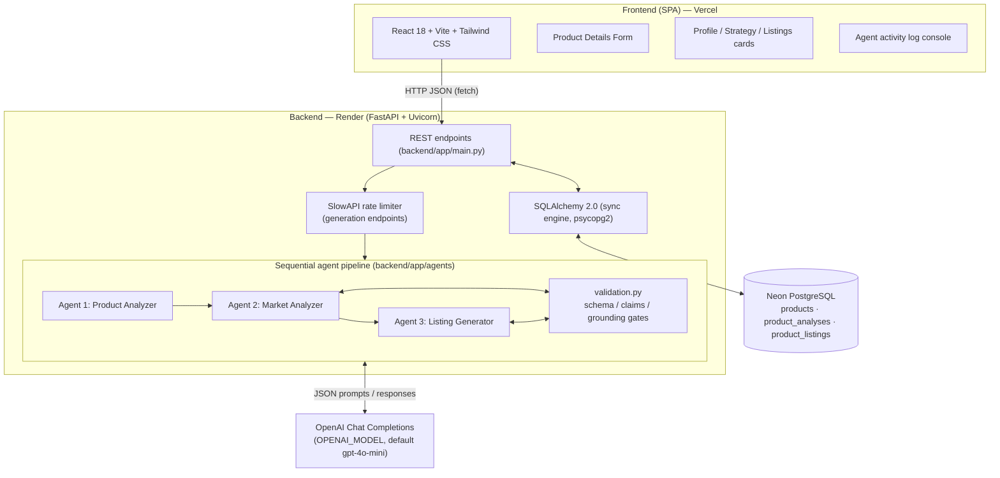
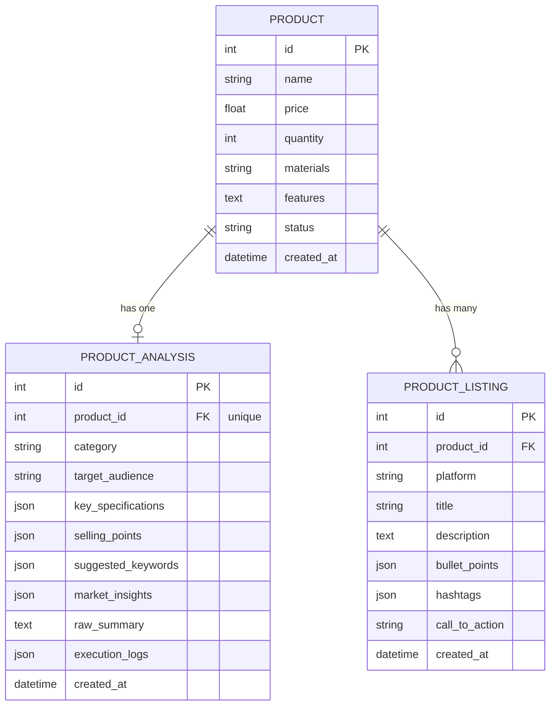
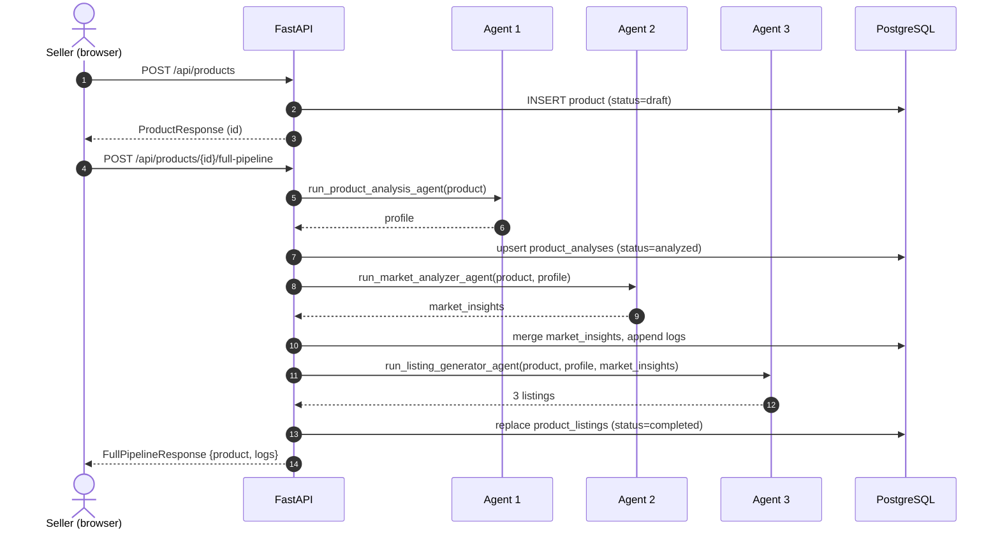
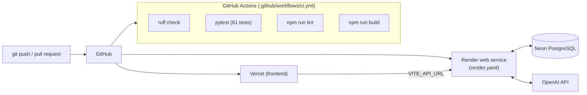

# Online Seller Assistant — System Architecture

> **Release:** v1.0.0 (see [CHANGELOG](../CHANGELOG.md); API version in `backend/app/config.py`)
> **Status:** Deployed
> **Live Web App:** [https://online-seller-assistant-three.vercel.app](https://online-seller-assistant-three.vercel.app)
> **Live API (Render):** [https://online-seller-assistant-backend.onrender.com](https://online-seller-assistant-backend.onrender.com)
> **API Swagger Docs:** [https://online-seller-assistant-backend.onrender.com/docs](https://online-seller-assistant-backend.onrender.com/docs)
> **Repository:** [https://github.com/BenaiahAsis/online-seller-assistant](https://github.com/BenaiahAsis/online-seller-assistant)

This document describes the system **as it is implemented in this repository**. Ideas that are
planned but not built are listed separately in [Section 10](#10-not-implemented-future-work).

---

## 1. Overview

**Online Seller Assistant** helps small online sellers in the Philippines write product listings for
**Shopee, TikTok Shop, and Lazada**. A seller enters basic product details (name, price in ₱, stock
quantity, materials, and free-form notes). The backend then runs a sequential three-agent pipeline:

1. **Agent 1 — Product Analyzer:** organizes the raw details into a structured product profile
   (category, target audience, key specifications, selling points, search keywords).
2. **Agent 2 — Market Analyzer:** turns that profile into a selling strategy (price tier, ranked
   selling points, likely buyer concerns, and a positioning angle for each platform).
3. **Agent 3 — Listing Generator:** writes one ready-to-paste listing per platform (title,
   description, bullet points, hashtags, call to action).

All three agents pass every AI response through a **validation layer** that rejects schema errors,
unsupported marketing claims, and text not grounded in the seller's input. When the AI is unavailable
or its output is rejected, each agent falls back to a deterministic, rule-based result, so the
pipeline always completes.

---

## 2. Architecture & Tech Stack



| Component | Technology | Notes |
| :--- | :--- | :--- |
| **Frontend** | React 18, Vite 5, Tailwind CSS 3 | Single-page app; API base URL from `VITE_API_URL` |
| **Backend** | FastAPI, Uvicorn, Pydantic v2 | All routes in `backend/app/main.py`; Swagger at `/docs` |
| **Database** | PostgreSQL (Neon), SQLAlchemy 2.0 (sync) | Tables created at startup; see [Section 3](#3-database-schema) |
| **AI** | OpenAI Python SDK | Model set by `OPENAI_MODEL` (default `gpt-4o-mini`); deterministic fallback when no key is set |
| **Rate limiting** | SlowAPI | `RATE_LIMIT_GENERATE_LISTING` (default `5/minute` per IP) on listing generation and full pipeline |
| **Tooling** | Ruff, Pytest, ESLint | Run in GitHub Actions on every push to `main` and every pull request |
| **Hosting** | Render (API), Vercel (frontend), Neon (DB) | Render service defined in `render.yaml` |

---

## 3. Database Schema



Defined in `backend/app/models.py`. Deleting a product cascades to its analysis and listings.

- **`products`** — raw seller input. `status` moves `draft` → `analyzed` → `completed`.
- **`product_analyses`** — one row per product.
  - Agent 1 writes `category`, `target_audience`, `key_specifications`, `selling_points`,
    `suggested_keywords`, and `raw_summary`.
  - Agent 2 merges its output into `market_insights` (`price_tier`, `price_rationale`,
    `priority_points`, `buyer_objections`, `platform_strategies`).
  - `execution_logs` holds the structured log entries from all three agents.
- **`product_listings`** — one row per platform (`shopee`, `tiktok`, `lazada`). It is replaced each
  time listings are regenerated.

**Schema changes.** There is no migration tool. On startup, `init_db()` in `backend/app/database.py`
runs `Base.metadata.create_all()` and then adds two later columns (`market_insights`,
`execution_logs`) with `ALTER TABLE ... ADD COLUMN IF NOT EXISTS`.

---

## 4. The Three-Agent Pipeline



The full pipeline is one synchronous request. Each step can also be triggered on its own
(`/analyze`, `/market-analysis`, `/generate-listings`). When an earlier step has not run yet, a later
step runs it first.

### Agent 1 — Product Analyzer (`backend/app/agents/product_analyzer.py`)
- **Rule-based profile:** keyword rules infer a specific category and target audience (for example,
  smartwatch terms → "Wearables & Smartwatches"). This profile is always computed and serves as the
  fallback.
- **AI profile:** if `OPENAI_API_KEY` is set, the model fills the Pydantic model `ProductProfile`
  (category, target audience, 1–5 selling points, 1–8 keywords, summary) through the shared
  validation layer ([Section 5](#5-validation-layer-backendappagentsvalidationpy)). Its grounding
  checks require:
  - every selling point to reuse words from the seller's name, materials, or notes
  - every keyword to share a word with them
  - no keyword to be a bare raw material or filler word (zinc, iron, "free", "best", …)
- **Failure handling:** if the API errors or both attempts are rejected, the rule-based profile is
  used. Key specifications (price, stock, materials) always come from the seller's input, never the
  model.
- **Extra output:** for thin input it adds follow-up questions for the seller, and it records
  unverified claims that were softened (for example, "Most bought item" → "Popular choice among
  buyers").

### Agent 2 — Market Analyzer (`backend/app/agents/market_analyzer.py`)
- **Price tier:** computed by the backend, not the AI.
  - **Budget-Friendly:** under ₱500
  - **Mid-Tier Value:** ₱500 – ₱2,500
  - **Premium:** over ₱2,500
- **AI output** (Pydantic model `MarketAnalysis`):
  - a one-sentence price rationale
  - 2–5 priority points, each tied back to an Agent 1 selling point by index
  - 2–4 buyer objections, each with a response angle
  - a strategy for each platform (focus, angle, tone, emphasised keywords)
- **Scope rule:** the prompt forbids new product facts, warranties, authenticity, certification, or
  shipping claims.

### Agent 3 — Listing Generator (`backend/app/agents/listing_generator.py`)
- **Output:** exactly one listing per platform (`ListingBundle` validates that all three are
  present).
  - **Shopee:** keyword-rich search title (under 120 characters)
  - **TikTok Shop:** short hook-first title
  - **Lazada:** trust-oriented title
- **Hashtags:** must come from Agent 1's approved keywords or fixed channel tags (`#shopeeph`,
  `#tiktokshopph`, `#lazadaph`, …). Raw-material tags such as `#zinc` are rejected.
- **Fallback:** a rule-based template builds all three listings from the seller's own details. The
  UI labels this "Template version (AI unavailable)".

---

## 5. Validation Layer (`backend/app/agents/validation.py`)

All three agents call the model through `call_agent()`, which works as follows:

1. **Strict structured output.** The Pydantic model is converted to a strict JSON schema
   (`strict_schema()`) and sent with `response_format={"type": "json_schema", "strict": true}`.
2. **The response passes three gates in order:**
   - **Schema gate:** the JSON must validate against the Pydantic model.
   - **Claims gate:** regex rules flag claims the seller never made. Categories:
     - policy (guarantee, warranty, refund)
     - authenticity or condition ("authentic", "brand new")
     - certification ("FDA", "ISO", "certified")
     - health or safety ("hypoallergenic", "BPA")
     - durability ("waterproof")
     - superlative or ranking ("best", "#1")
     - comparative ("better than")
     - logistics or stock ("free shipping", "limited stock")
     - quality assurance ("lab-tested")

     A claim is allowed only when supporting words appear in the seller's input.
   - **Grounding gate:** agent-specific checks that the text reuses the seller's own facts and
     approved keywords.
3. **Retry once.** On rejection, the violations go back to the model with an instruction to
   correct them (`MAX_ATTEMPTS = 2`).
4. **Fall back.** If both attempts fail, or the API errors, the agent returns its deterministic
   fallback.

Every attempt is recorded as a validation event: accepted, rejected (with gates and violations),
api_error, or skipped. These events are written into `execution_logs`, so the frontend log console
shows exactly why an output was accepted or replaced.

### Simulating AI failures (demo aid)

When the backend runs with `ALLOW_AI_FAILURE_SIMULATION=true`, the four agent endpoints accept an
`X-Simulate-AI-Failure` header (exposed in Swagger). `backend/app/agents/simulation.py` then gives
every agent a stand-in client instead of the real one:

- `api_error`: every call raises a simulated provider outage.
- `bad_output`: every call returns malformed JSON containing invented claims.

The normal gates, retry, and fallback code then runs unchanged. The request still succeeds with
rule-based output, and the logs show `API_ERROR` or `VALIDATE_REJECT` followed by the fallback.
When the setting is off, the header is refused with `403`.

### Choosing the AI provider

The agents use the OpenAI Python SDK. `OPENAI_BASE_URL` can point them at any OpenAI-compatible
endpoint. For example, GitHub Models (`https://models.github.ai/inference`) with
`OPENAI_MODEL=openai/gpt-4o-mini` offers a free, rate-limited tier.

---

## 6. Execution Logs

`backend/app/agents/logger.py` builds structured entries
(`timestamp`, `agent`, `stage`, `level`, `message`, `details`) for each agent run and writes them to
`product_analyses.execution_logs`.

- **Re-runs:** re-running an agent replaces only that agent's entries.
- **Delivery:** logs are returned in the `full-pipeline` response and from
  `GET /api/products/{id}/logs`. They are **not streamed**.
- **Progress display:** while a request is in flight, the frontend shows its own progress messages
  in the log console. It then replaces them with the stored entries.

---

## 7. REST API

All routes are defined in `backend/app/main.py`. Interactive documentation is available at `/docs`.

| Method | Endpoint | Description |
| :--- | :--- | :--- |
| `GET` | `/` | Service metadata |
| `GET` | `/health` | Runs `SELECT 1`; returns `200` when the database is reachable, otherwise `503` |
| `POST` | `/api/products` | Create a product (`ProductCreate`) |
| `GET` | `/api/products` | List all products with analysis and listings |
| `GET` | `/api/products/{id}` | Get one product |
| `PATCH` | `/api/products/{id}` | Edit a product's name, price, stock, materials, or notes (only the fields sent). Existing analysis and listings are kept until regenerated |
| `DELETE` | `/api/products/{id}` | Delete a product, its analysis, and its listings |
| `POST` | `/api/products/{id}/analyze` | Run Agent 1 |
| `POST` | `/api/products/{id}/market-analysis` | Run Agent 2 (runs Agent 1 first if needed) |
| `POST` | `/api/products/{id}/generate-listings` | Run Agent 3 (runs Agents 1–2 first if needed). **Rate limited** |
| `POST` | `/api/products/{id}/full-pipeline` | Run Agents 1 → 2 → 3 in one request. **Rate limited** |
| `GET` | `/api/products/{id}/logs` | Get the stored execution logs |
| `GET` | `/api/products/{id}/listings` | Get the generated listings |
| `PATCH` | `/api/listings/{listing_id}` | Edit a listing's title, description, bullets, hashtags, or call to action |

The generation and full-pipeline routes also accept hidden aliases kept for backward compatibility:
`/api/products/{id}/generate-listing` and the same paths under `/api/v1/`. These aliases do not
appear in the OpenAPI schema.

**Errors.**
- **Invalid input:** malformed or invalid requests get FastAPI's `422` response, with field-level
  messages.
- **Unknown IDs:** return `404`.
- **Rate limit:** exceeding it returns `429`.
- **Unhandled exceptions:** return a JSON `500` with a generic message. The exception text is
  logged server-side, not returned. A custom middleware ensures CORS headers are still attached.

CORS: Allowed origins come from `CORS_ORIGINS` (comma-separated), plus any
`https://*.vercel.app` origin.

---

## 8. Frontend Structure

```
frontend/src/
├── App.jsx                       # App state, API calls, layout: form, profile card, catalog, System Status tab
├── components/
│   ├── AgentLogsConsole.jsx      # Collapsible log console with per-agent filters
│   ├── ProductEditForm.jsx       # Edit a saved product's details (PATCH /api/products/{id})
│   ├── MarketStrategyCard.jsx    # Agent 2 output: price level, selling points, buyer concerns, platform angles
│   └── ListingPreview.jsx        # Agent 3 output: platform tabs, copy buttons, inline title/description editing
├── index.css                     # Tailwind directives
└── main.jsx                      # React entry point
```

**Main features:**
- One-click example products to fill the form.
- A four-step progress indicator.
- A saved-products catalog with search and delete, plus **Edit Details** on the selected product.
- Per-platform listing tabs with copy buttons for the full listing, title, or description, and
  inline editing.
- A **System Status** tab that polls `/health` and shows a notice while the free-tier backend
  wakes up.

---

## 9. CI/CD & Deployment



- **CI** runs on every push to `main` and on every pull request. It has two jobs:
  - **Backend:** Python 3.12, `ruff check`, `pytest`.
  - **Frontend:** Node 20, `npm run lint`, `npm run build`.
- **Backend deploy:** `render.yaml` sets `rootDir: backend`, installs `requirements.txt`, and starts
  `uvicorn app.main:app --port $PORT`, with `/health` as the health check. `OPENAI_API_KEY`,
  `DATABASE_URL`, `JWT_SECRET`, and `CORS_ORIGINS` are set in the Render dashboard.
- **Frontend deploy:** Vercel builds the `frontend/` app with `vite build`. Its settings are kept in
  the Vercel dashboard, not in this repository.
- **Tests never call OpenAI.** The test suite uses in-memory SQLite, scripted fake clients, and a
  `conftest.py` fixture that removes any real `OPENAI_API_KEY` from the environment.

---

## 10. Not Implemented (Future Work)

These items appeared in earlier plans but are **not part of the current code**:

- **User accounts / JWT authentication.** `JWT_SECRET` is declared in `.env.example` and
  `render.yaml`, but no code uses it. All products are visible to every visitor.
- **Live streaming of agent progress** (Server-Sent Events or WebSockets). Logs are returned after
  each request completes.
- **Additional platforms** such as Carousell and Instagram.
- **Profit-margin or recommended-price calculation.** Agent 2 classifies the seller's price into a
  tier but does not suggest a different price.
- **Database migrations** with Alembic.
